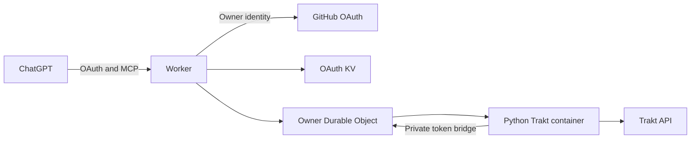

# Private Trakt MCP on Cloudflare

A single-owner ChatGPT connector for viewing history, TV progress, recommendations,
watchlists, and ratings. Runs a pinned [wwiens Trakt server](https://github.com/wwiens/trakt_mcpserver)
behind the owner-only OAuth gateway adapted from
[the Intervals template](https://github.com/lirantal/cloudflare-intervals-icu-mcp-template).

GitHub OAuth verifies the exact numeric owner. ChatGPT receives separate gateway
tokens with S256 PKCE, explicit browser-bound consent, audience checks, and refresh
validation. Public discovery/registration never grants access to your data.



The public template defaults to `read-only` (29 tools, including three account
authorization tools). Private `accessMode: track` adds **mark watched**, **add to
watchlist**, and **save rating** (32 tools). Writes require intentional user
requests; marking history twice may create duplicate plays. Deletion, check-ins,
scrobbling, and recommendation hiding are excluded at registration. Saving a
rating may replace an existing rating. `clear_auth` disconnects Trakt; it does not
delete viewing data.

Trakt tokens persist in Cloudflare Durable Object storage before login/refresh
reports success. Container disk is never the source of truth. Container restarts
retain authorization; an unfinished device-code flow must be restarted.

## Setup

Requires Node from `.node-version`, Docker with Linux amd64, Chrome/Chromium,
and a Cloudflare Workers Paid account with Containers. Usage is billable; one
named instance and ten-minute idle sleep are not a spending cap.

```sh
npm ci
npm run check:public
npm run check
REQUIRE_BROWSER_TESTS=true npm test
docker build --platform linux/amd64 -t trakt-mcp:test .
npm run test:container
npm run test:adapter
npm run build
npx cf deploy --prebuilt --mode production --dry-run
```

Copy `deployment.json` to ignored mode-0600 `deployment.local.json`. Fill your
account, stable origin, verified numeric GitHub owner ID, GitHub OAuth Client ID,
and Trakt Development app Client ID. Set `accessMode` to `track` for the three
tracking tools. Keep `deleteMode: none`. `TRAKT_DEPLOYMENT_FILE` selects an
alternative private settings file. No credentials or personal settings belong in
the public template.

Follow [deployment](docs/DEPLOYMENT.md), including secure GitHub secret entry.
Connect ChatGPT to **`PUBLIC_ORIGIN/mcp`**, choose **OAuth**, and leave client
credentials blank when optional. Approve consent and GitHub login. Then ask the
connector to **start Trakt device authorization**, approve the displayed code on
Trakt, and ask it to **check authorization status**. Refresh tools after changes.

- [Upstream comparison and decision](docs/UPSTREAM.md)
- [Architecture and token trust boundary](docs/ARCHITECTURE.md)
- [Deployment and secure credentials](docs/DEPLOYMENT.md)
- [Operations and acceptance](docs/OPERATIONS.md)
- [Validation status](docs/VALIDATION.md)

Gateway: Apache-2.0. Trakt server: MIT; its notice is included in the image.
Source commits and modifications are recorded in [NOTICE](NOTICE).
