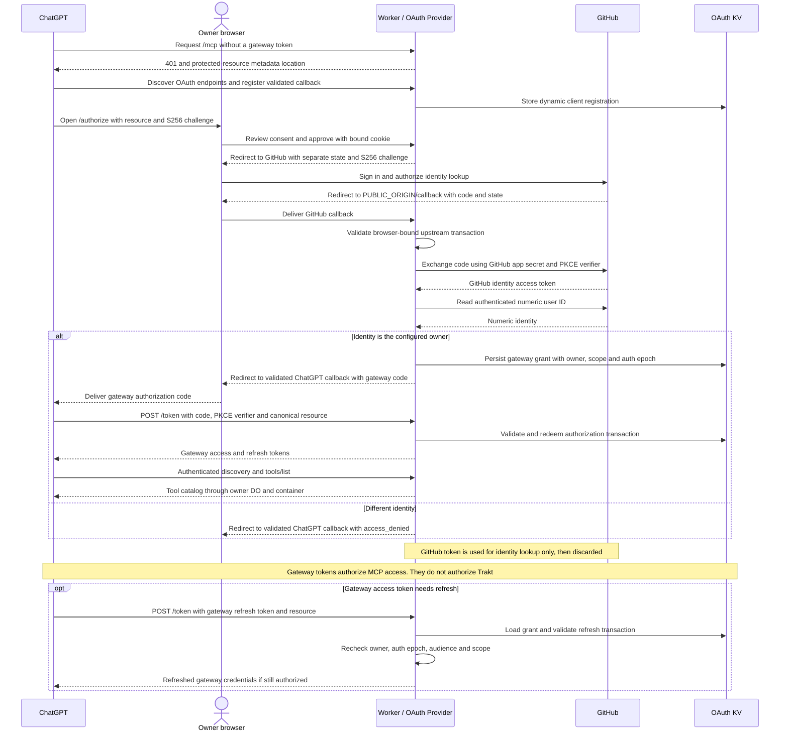
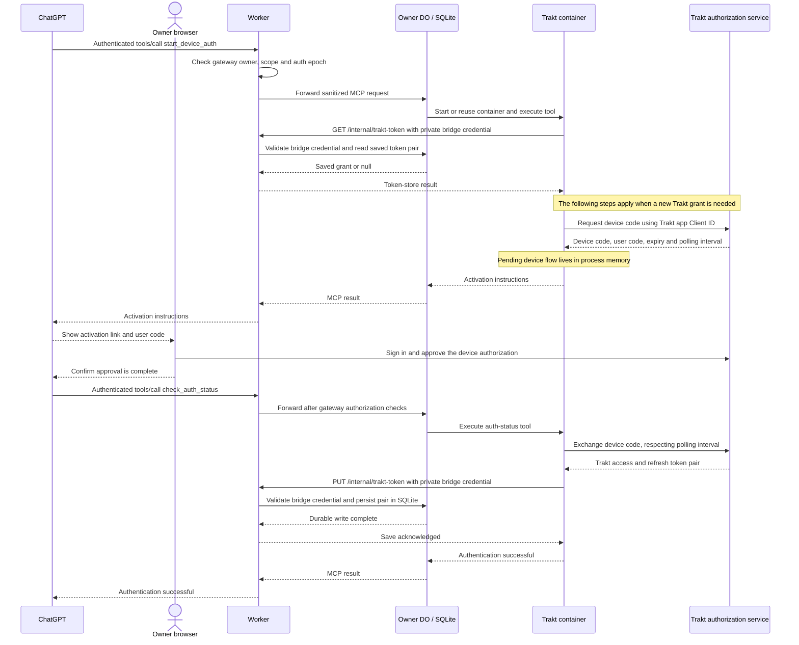
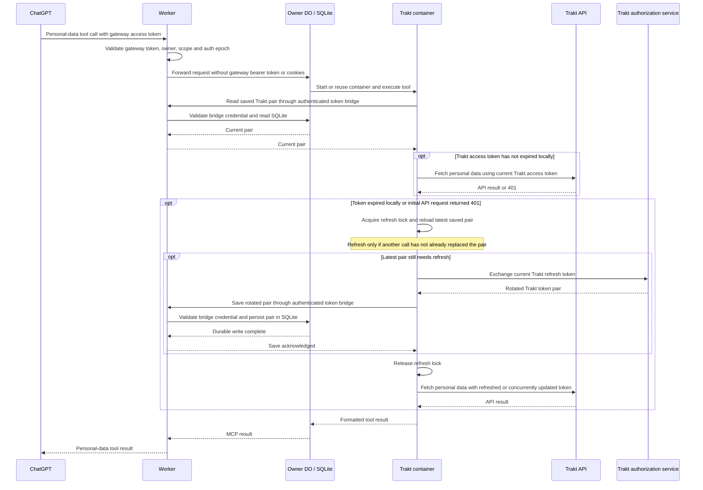

# Architecture

The Worker is the public MCP ingress. `workers-oauth-provider` supplies discovery,
dynamic registration, consent cookies, code exchange, and encrypted OAuth grants
in KV. GitHub tokens are used only to look up the numeric owner identity, then
discarded. Exact owner, audience, scope and `authEpoch` are checked on requests
and token refresh. ChatGPT callbacks are explicitly validated. No Cloudflare
Access gate belongs in front of the OAuth endpoints.

## Authentication sequence diagrams

Two independent authorizations are required: GitHub establishes who may use the
gateway, then Trakt grants access to that owner's viewing account. A visible
tool catalog establishes the first connection; a personal-data query after
Trakt approval verifies both. The diagrams show logical messages; token values
and device codes are deliberately omitted.

### 1. ChatGPT connects through GitHub owner login

The GitHub app callback is `PUBLIC_ORIGIN/callback`. ChatGPT's callback belongs
to its dynamically registered client and is validated separately. GitHub's
`GITHUB_CLIENT_SECRET` remains a Worker Secret; ChatGPT never receives it.

### 2. The owner authorizes Trakt using a device code

Current Trakt Development apps use this flow without a client secret. Their
required registered redirect URI (`http://localhost`) is not a callback listener
for device authorization. The container-to-Worker bridge uses HTTPS, an explicit
application User-Agent and a distinct private credential generated by the DO.
ChatGPT receives activation instructions and tool results, never the Trakt token
pair or bridge credential. Unfinished device flows expire or disappear on
container restart; a successfully saved grant remains in SQLite.

### 3. Personal-data calls and independent Trakt token refresh

This is the successful read path. Trakt may reject a grant or return a transient
error; those failures do not authorize gateway access or imply that reconnecting
GitHub will repair Trakt. The upstream's bounded authentication recovery is
separate from the gateway, which never automatically replays a tool call.
Gateway refresh state lives in OAuth KV; the Trakt pair and bridge key live in
the owner's DO storage. Rotating one token family does not rotate the other.
Changing `authEpoch` invalidates gateway authorizations without erasing the Trakt
grant. The refresh-write failure window and recovery limits are described below.

The gateway preserves the reference implementation's browser protections:
same-origin Referrer-Policy for consent POST, exact Origin check, cookie-bound
consent, and CSP form-action destinations for GitHub and ChatGPT redirects.
Browser tests exercise Continue and Cancel.

Authorized MCP requests have bearer tokens, cookies and untrusted forwarding
headers removed. Standard MCP protocol/method/name/parameter headers are kept.
The fixed owner Durable Object forwards to port 8080 of one lite container.
Redirects are rejected; tool calls are never automatically retried. The container
is nonroot, sleeps after ten idle minutes, and restarts when image or relevant
runtime settings change. No public container port is configured.

## Trakt token persistence

The upstream filesystem token store is replaced before clients create token stores.
The replacement synchronously loads/saves the current pair through
`/internal/trakt-token` on this Worker. The exact route bypasses ChatGPT OAuth
only for a distinct, random per-owner bridge credential. That credential is
generated and stored in the Durable Object and injected into the container at
runtime. It is never sent to ChatGPT, baked into an image, or committed.

The bridge uses HTTPS without redirects; it permits only bounded token reads,
validated token writes and disconnect. Unauthenticated calls return 404. It has
no general-purpose storage access and cannot call Trakt. Token pairs are stored
in the owner's SQLite Durable Object, protected by Cloudflare's storage controls;
there is no extra application encryption key. Treat the Cloudflare account and
container as trusted credential holders.

Bridge requests identify the application with an explicit User-Agent. Python's
default urllib user agent received HTTP 403 during live acceptance; retaining
the explicit header is covered by regression tests. Expected errors expose only
HTTP status/known edge classification or network/TLS category, never the remote
response body or credential-bearing request. See the
[incident and verification](TROUBLESHOOTING.md#token-storage-http-403-and-the-application-user-agent).

Refresh is serialized inside the single container process. The new token pair
must be durably saved before the upstream save operation succeeds. A storage
failure becomes an error; it is not silently treated as memory-only success.
There remains an unavoidable failure window if the process dies after Trakt
rotates a token and before the durable write completes. Recover by reauthorizing.
An unfinished device flow is ephemeral and may need restarting after idle sleep.

No requests, headers, URLs, bodies, account data or token values are logged.
Worker observability and Python application logs are disabled. Resource listing
and prompts remain upstream functionality; they require owner authorization.

The `cf` beta self-binding metadata workaround from the reference is retained:
`unsafe:durable_object_namespace` names the local class. It does not create an
unauthenticated ingress. Use the pinned official `cf` and `cloudflare.config.ts`.
